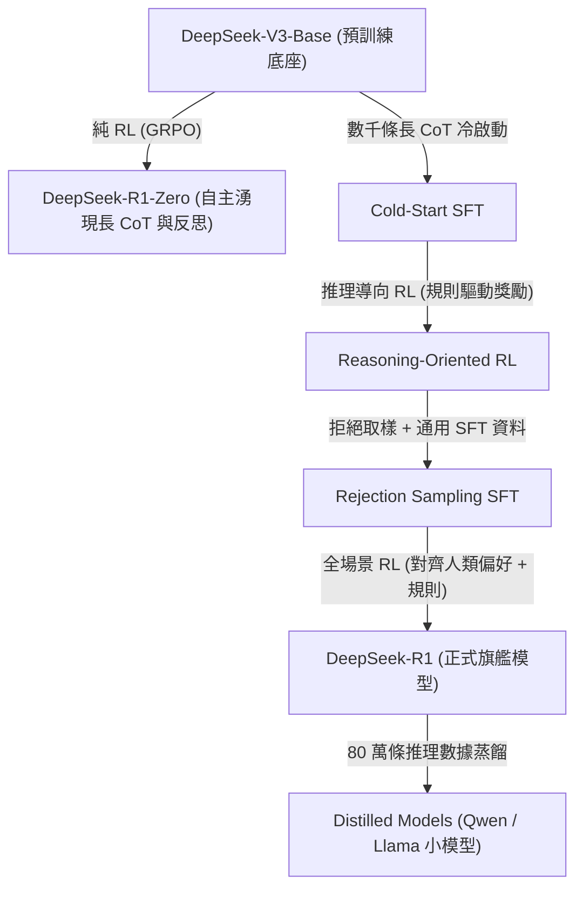

# DeepSeek-R1

## 核心定義與架構概述
DeepSeek-R1 是由 DeepSeek-AI 於 2025 年 1 月發布的大型推理語言模型。該模型的核心突破在於驗證了**純強化學習（Reinforcement Learning, RL）可在不依賴大規模人類標註 SFT（監督式微調）資料的前提下，自主激發出高度複雜的邏輯推理與反思能力**。

DeepSeek-R1 系列包含兩個主要探索分支：
1. **DeepSeek-R1-Zero**：基於預訓練底座 [[DeepSeek-V3-Base]]，不經過任何 SFT 冷啟動，直接採用 [[Group Relative Policy Optimization (GRPO)]] 進行純 RL 訓練。
2. **DeepSeek-R1 正式版**：為修正 R1-Zero 在語言可讀性、語言混雜（Code-switching）以及格式混亂等工程問題，設計了結合冷啟動資料（Cold-start data）、推理專項 RL、拒絕取樣（Rejection Sampling）再微調、以及全場景 RL 的四階段訓練流程。

底層架構上，R1 延續了 [[Multi-Head Latent Attention (MLA)]] 與混合專家架構（MoE），總參數量為 671B，每個 Token 激活約 37B 參數。

## 訓練管線與技術機制

### 1. R1-Zero 的純 RL 湧現現象
在 R1-Zero 的訓練中，獎勵模型（Reward Model）完全由客觀規則驅動：
- **正確性獎勵（Accuracy Reward）**：針對數學題或代碼輸出，透過編譯器或確定性符號檢查器給出 0/1 獎勵。
- **格式獎勵（Format Reward）**：強制要求思考過程封裝於 `<think>...</think>` 標籤中。

在無任何人類範例示範下，模型隨著 RL 迭代步數增加，自主發展出回溯（Backtracking）、自我懷疑（Wait, let me double check...）、重新嘗試替代解法等高階認知行為，推理過程 Token 數自發性拉長數倍，驗證了 [[Test-Time Compute]] 的自發性擴展。

### 2. 知識蒸餾實驗
DeepSeek 團隊利用 DeepSeek-R1 產生的 80 萬條高質量合成推理資料，對開源密集模型（Qwen-2.5 與 Llama-3.1）進行監督微調。實驗結果顯示，蒸餾後的 DeepSeek-R1-Distill-Qwen-32B 在 AIME 2024 上取得 72.6% 的 Pass@1，遠超直接在 32B 模型上運用 RL 的效果，證明**大模型的推理結構與思維模式可被高保真度地轉移至小模型**。

## 評測指標
在 [[Math Reasoning Benchmarks]] 與程式競賽中，DeepSeek-R1 展現了與 OpenAI-o1 正式版可匹敵的性能：
- **AIME 2024**：Pass@1 達到 79.8%（Consensus@64 達 92.3%）。
- **MATH-500**：Pass@1 達到 97.3%。
- **Codeforces**：百分位評分超越 96.3% 人類參賽選手。

## 局限性與未解問題
1. **通用任務能力衰退（Tax of Reasoning）**：專注於極長思維鏈的訓練有時會損害簡短問答、軟性對話或角色扮演體驗。
2. **多語言與跨領域泛化**：在缺乏確定性驗證器（如軟性文史哲領域）的任務中，純規則獎勵難以定義。
