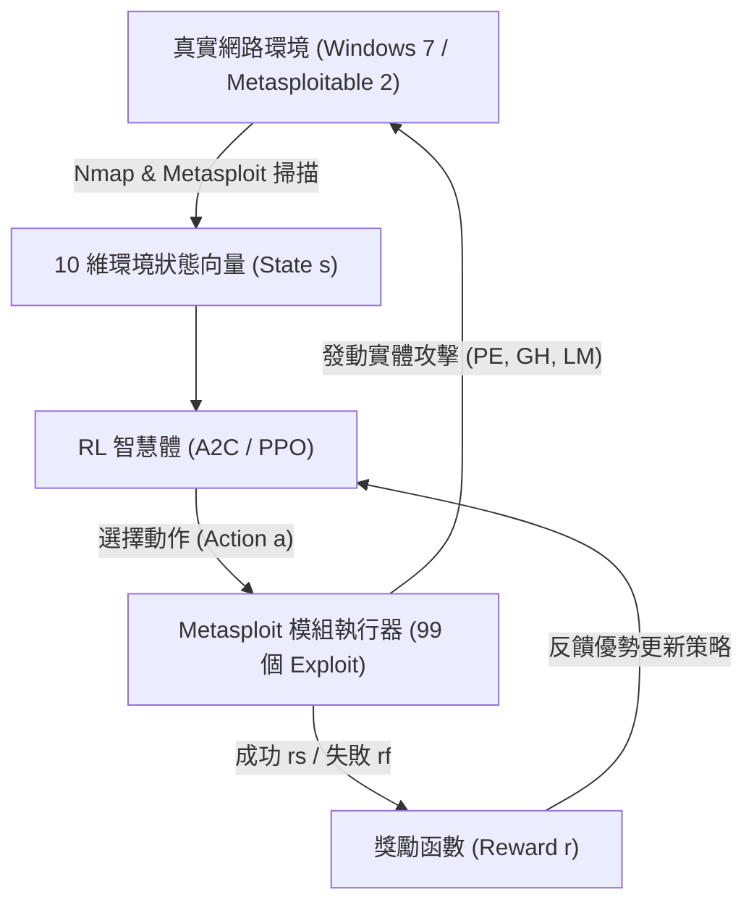

# Raiju 後滲透自動化框架 (Raiju Framework)

## 核心定義與研究背景
Raiju 是一個由 Van-Hau Pham 等人於 2024 年發表於 *Computer Networks* 的強化學習導向後滲透（Post-Exploitation）自動化測試框架。

在網路安全與紅隊演練（Red Teaming）中，攻擊者在取得目標系統初步存取後，需要實施複雜的後續攻擊，主要包括三大目標：
1. **權限提升（Privilege Escalation, PE）**：取得本機管理員（Windows Administrator / NT SYSTEM）或 Linux Root 權限。
2. **憑證收集（Gathering Hashdump, GH）**：傾印並獲取使用者密碼雜湊，供後續解密或橫向滲透。
3. **橫向移動（Lateral Movement, LM）**：利用已控制節點探索相鄰主機（如 SMB 445 埠），擴大攻擊戰果。

傳統滲透工具（如 Metasploit、Empire）需高度仰賴人工專家手動配置參數並逐步下達決策。Raiju 透過強化學習 Agent 自主感知環境狀態並挑選最適利用模組，達成端到端的後滲透自動化。

## 架構設計與運作機制

### 1. 狀態空間設計 (State Features)
Raiju 提取了 10 項具代表性的跨平台狀態特徵：
- `Platform`：目標作業系統（Windows / Linux / Unknown）。
- `Windows 安全機制`：UAC 狀態、Admin Group、Admin User、System User。
- `Linux 權限與核心`：Root User、Linux Kernel Vuln。
- `憑證狀態`：Hashdump 是否已成功提取。
- `拓撲探索`：相鄰節點數量（Number of peers）、目標節點索引與平台類型。

### 2. 動作空間 (Action Space)
整合 Metasploit 的 99 個成熟攻擊模組：
- Windows 權限提升：23 個模組。
- Linux 權限提升：72 個模組。
- 憑證提取（Hashdump）：2 個模組。
- SMB 服務橫向移動：2 個模組。

### 3. 獎勵機制設計 (Reward Modeling)
採用折扣累積獎勵 $R_t = \sum_{i=t}^T \gamma^{i-t} r_i$（$\gamma = 0.99$）。
論文實驗對比了兩種獎勵方案：
- **RW1**：成功得 $+1$，失敗扣 $-1$。
- **RW20**：成功得 $+20$，失敗扣 $-1$（由於正確動作稀疏且關鍵，RW20 顯著加速了策略收斂）。

## 實驗表現與核心結論
在 4 個混合複雜拓撲的實體測試環境中（ENV1 至 ENV4）：
- **成功率**：以 [[A2C 與 PPO 在滲透測試之對比 (A2C vs PPO in Pentesting)]] 為核心演算法時，綜合攻擊成功率突破 **84%**。
- **攻擊效率**：平均在 **55 個攻擊步數以內**即可完全滲透目標網路並獲取 Domain Controller / Root 控制權。
- **演算法優勢**：A2C 在多環境平行取樣下，效率與成功率顯著超越 PPO 與隨機代理（Random Agent）。
