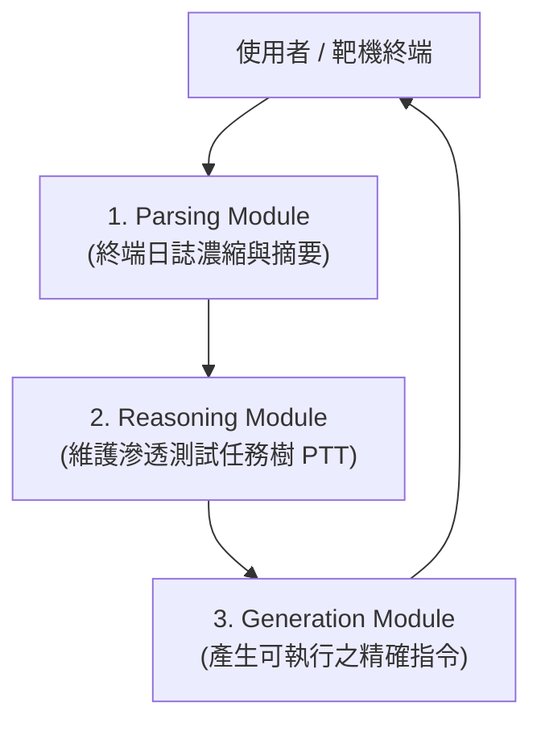

# PentestGPT: An LLM-powered Automated Penetration Testing Tool

## 1. 論文資訊 (Paper Metadata)
- **論文標題**：PentestGPT: An LLM-powered Automated Penetration Testing Tool
- **作者團隊**：Gelei Deng, Zhikai Chen, Yi Liu, Tianwei Zhang, Yang Liu (南洋理工大學 NTU)
- **發表會議**：*USENIX Security Symposium 2024* (資安四大頂級會議之一)
- **arXiv 連結**：[arXiv:2308.06782](https://arxiv.org/abs/2308.06782)

---

## 2. 核心動機與問題定義 (Problem Formulation)
滲透測試具備極高的認知複雜度，攻擊者必須在終端機中面對海量的非結構化輸出（如 Nmap 掃描日誌、Web 原始碼、錯誤訊息），並靈活調整攻擊決策。
過往嘗試直接使用 GPT-4 進行端到端滲透測試時，面臨三大致命瓶頸：
1. **Context Loss (上下文丟失)**：滲透測試會產生上萬行終端機輸出，迅速擠爆大語言模型的 Context Window。
2. **Domain Hallucination (領域幻覺)**：模型容易猜測不存在的漏洞參數或捏造 Exploit 指令。
3. **Task Structuring Failure (任務缺乏層次)**：模型容易迷失在單一目錄暴力破解中，無法像專業白帽駭客般維護全域攻擊樹（Attack Tree）。

---

## 3. PentestGPT 三模組架構設計 (Three-Module Agent Architecture)

為克服上述問題，PentestGPT 設計了一套解耦的多智能體協作架構：

1. **Reasoning Module (推理模組)**：
   - 不直接看冗長日誌，專注維護階層式「滲透測試任務樹 (Penetration Testing Task Tree, PTT)」。
   - 將攻擊流程拆解為：偵察 (Reconnaissance) $\rightarrow$ 漏洞枚舉 (Vulnerability Enumeration) $\rightarrow$ 提權與橫向移動 (Privilege Escalation)。
2. **Generation Module (指令生成模組)**：
   - 根據推理模組指派的微觀子任務，生成特定工具（如 `sqlmap`, `hydra`, `nmap`）的精準指令。
3. **Parsing Module (日誌解析模組)**：
   - 負責過濾、摘要巨量的終端機回應輸出，只提取出核心關鍵線索（如開了哪些 Port、找到哪些隱藏路徑），再回饋給推理模組。

---

## 4. 實驗評測與指標突破
- **測試靶場**：在業界公認標準的 **HackTheBox (HTB)** 與 **VulnHub** 實體靶機中評測。
- **實驗成果**：
  - PentestGPT 在無需人類干預下，成功完成多台容易與中等難度靶機的完整奪旗（Get Root / Capture The Flag）。
  - 對比傳統端到端 GPT-4，任務完成率提升超過 $228\%$，且 Token 消耗量大幅降低 $85\%$。

---

## 5. 關聯詞條
- [[Autonomous Penetration Testing]]
- [[Pham2024-Raiju.md]]
- [[LLM Security Agent]]
- [[DeepExploit]]
