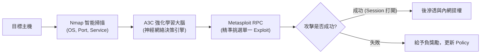

# DeepExploit: Fully Automated Penetration Testing Framework using Machine Learning

## 1. 論文/成果資訊 (Metadata)
- **專案名稱**：DeepExploit: Fully Automated Penetration Testing Framework using Machine Learning
- **作者**：Isao Takaesu (三井物產資安團隊)
- **發表場合**：*Black Hat USA 2018* / *DEF CON 26 Arsenal* (全球最具權威之頂級駭客年會)
- **開源專案**：[github.com/13o-bbr-bbq/machine_learning_security](https://github.com/13o-bbr-bbq/machine_learning_security)

---

## 2. 核心突破與開創性地位
在 2018 年之前，自動化滲透測試工具（如 AutoSploit）多半採用「亂槍打鳥（Brute-force Exploit Spraying）」的方式，盲目對目標 IP 嘗試所有 Metasploit 模組，這極易導致目標伺服器崩潰（DoS）或引發入侵偵測系統（IDS）強烈警報。
**DeepExploit 是全世界第一個成功將「非同步優勢動作評價演算法 (A3C)」與 Metasploit RPC 結合的自動化滲透框架**。

---

## 3. 系統工作機制 (System Workflow)

1. **高效狀態降維**：
   - 將 Nmap 偵察到的作業系統、開放連接埠、服務版本映射為離散特徵向量。
2. **A3C 多執行緒並行訓練**：
   - 利用多個 Worker 智能體同時對不同靶機進行平行滲透探索，顯著縮短了策略收斂時間。
3. **安全無害探索**：
   - 神經網絡學會優先挑選「利用成功率最高且不損害伺服器」的 Payload 模組，避免盲目攻擊引發的業務中斷。

---

## 4. 歷史意義與啟發
DeepExploit 開創了「RL + Metasploit」的經典技術路線，後續 2024 年的 《Raiju》 論文正是在 DeepExploit 的基礎上，大幅改善了跨平台狀態表示、獎勵函數稀疏性（引入 RW20），並將演算法從 A3C 升級至 A2C 與 PPO。

---

## 5. 關聯詞條
- [[Pham2024-Raiju.md]]
- [[Autonomous Penetration Testing]]
- [[A2C 與 PPO 在滲透測試之對比 (A2C vs PPO in Pentesting)]]
